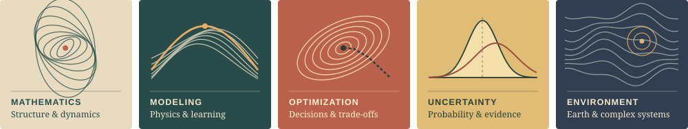
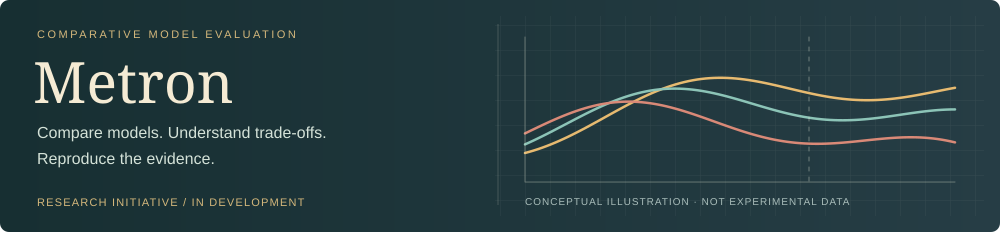

<h1 align="center">Gustavo Bernardo Brito</h1>

  Applied Mathematics &amp; Computational Science 
  Undergraduate at the Federal University of Goiás (UFG), Brazil.

  Mathematical modeling · Scientific machine learning · Optimization · Uncertainty quantification

  <a href="https://gustavobernardo1.github.io">Website (under construction)</a> ·
  <a href="http://lattes.cnpq.br/9675299775092117">Curriculum Lattes</a>

  

---

<h2 align="center">Featured project</h2>

  

  Reproducible benchmarking of mathematical, process-based and machine learning models. 
  First investigation: soybean crop models. Currently in protocol design. 
  <a href="https://github.com/gustavobernardo1/metron">Repository</a> · <a href="https://github.com/gustavobernardo1/metron/blob/main/METHODOLOGY.md">Methodology</a>

## Research

- **Agricultural modeling** — soybean yield gaps and agricultural efficiency.
- **Environmental data science** — rainfall variability and hydroclimatic analysis in the Brazilian Cerrado.

## Projects & studies

- **Helios** — physics-guided solar forecasting and stochastic energy optimization. In development.
- **Conjectura** — AI-assisted mathematical discovery and formal verification with Lean 4. Independent research initiative.
- [**Computational Mathematics**](https://github.com/gustavobernardo1/computational-mathematics) — numerical methods, dynamical systems and optimization studies.
- [**Scientific ML**](https://github.com/gustavobernardo1/scientific-ml) — inverse problems, physics-guided learning and reproducible experiments.
- [**Mapa dos Ipês**](https://github.com/gustavobernardo1/mapa-dos-ipes) — citizen science and geospatial engineering.

Artwork: original conceptual mathematical illustrations, not experimental results. Research data and unpublished findings are shared only when authorized.
