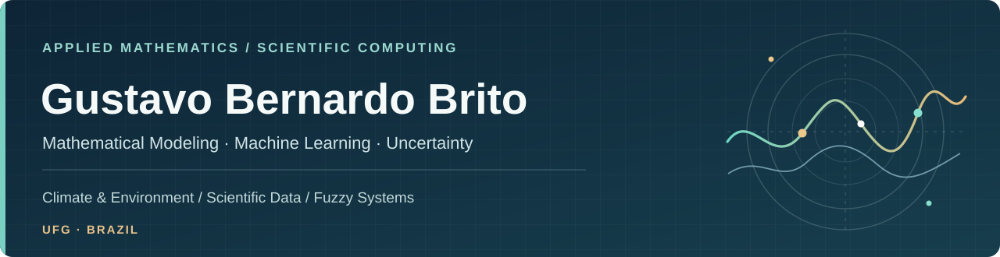
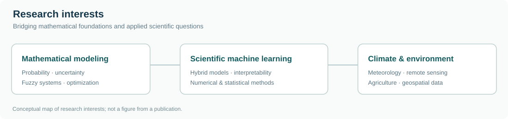

**Undergraduate researcher in Applied and Computational Mathematics at the Federal University of Goiás (UFG), Brazil**

## About me

I'm an undergraduate student in **Applied and Computational Mathematics** at the **Federal University of Goiás (UFG)**, part of the program's inaugural cohort.

My work connects **mathematical modeling, probability, statistical learning, and uncertainty** with practical questions in agriculture, climatology, multicriteria decision-making, and scientific computing.

I'm particularly interested in **scientific machine learning**, **hybrid and neuro-fuzzy models**, **meteorology**, and **remote sensing**. I enjoy projects that combine a rigorous mathematical foundation with computational experiments and interpretable outcomes.

## Research interests

- **Mathematics & uncertainty:** probability, decision theory, fuzzy inference, AHP/ANP, statistical and numerical methods.
- **Scientific machine learning:** hybrid models, neuro-fuzzy systems, interpretable predictive modeling, and scientific computing.
- **Climate & environmental data:** rainfall trends, meteorology, geospatial data, satellite imagery, and environmental monitoring.
- **Agriculture & applied statistics:** soybean productivity, climate–agriculture relationships, and statistical models for real-world phenomena.

## Selected projects

<table>
<tr>
<td width="50%" valign="top">

### [DecisionLab](https://github.com/gustavobernardo1/decisionlab)

**Multicriteria Decision Analysis**

Interactive educational software for exploring AHP/ANP judgments, criterion weights, consistency, ranking, and sensitivity analysis.

**Methods:** AHP · ANP · uncertainty modeling

[Repository](https://github.com/gustavobernardo1/decisionlab) · [Live demo](https://decisionlab-navy.vercel.app)

</td>
<td width="50%" valign="top">

### [GraphCube Lab](https://github.com/gustavobernardo1/graphcube-lab)

**Computational Mathematics & Algorithms**

Interactive investigation of Rubik's Cube mathematics through permutation groups, state and Cayley graphs, graph search, and reproducible computational experiments.

**Methods:** group theory · graph theory · heuristic search

[Repository](https://github.com/gustavobernardo1/graphcube-lab) · [Technical paper](https://github.com/gustavobernardo1/graphcube-lab/blob/main/paper/main.pdf)

</td>
</tr>
<tr>
<td colspan="2" valign="top">

### [Mapa dos Ipês](https://github.com/gustavobernardo1/mapa-dos-ipes)

**Citizen Science & Environmental Data**

Geospatial platform for mapping urban ipê trees and recording flowering observations in Goiânia. An exploratory research direction examines the potential and limitations of satellite imagery for studying tree phenology; **automated satellite detection is not an implemented feature**.

**Methods & tools:** geospatial data · PostGIS · citizen science · exploratory remote sensing

[Repository](https://github.com/gustavobernardo1/mapa-dos-ipes) · [Web application](https://mapa-dos-ipes.vercel.app)

</td>
</tr>
</table>

## Current academic work

| Research direction | Focus |
| --- | --- |
| **Rainfall trends in the Brazilian Cerrado** | Historical rainfall variability, seasonality, climatic trends and agricultural implications. |
| **Soybean productivity** | Statistical and computational approaches to understanding agricultural productivity. |
| **Fuzzy credit analysis** | Credit assessment and decision support using fuzzy inference. |
| **Basketball shot modeling** | Mathematical and statistical modeling of shot success probability. |

Some ongoing research involves academic collaborators and is not publicly available in repository form. The public projects above do not necessarily correspond to the complete research programs.

## Academic activities & recognition

- **Datathon winner — ENGOPE (2026).**
- **ENGOPE (2026):** poster presentation on mathematical modeling of basketball shot success.
- **SENIC (2026):** scientific research presentation.
- **CONPEEX/UFG (2026):** scientific research presentation.
- **Research manuscript:** submitted to *Nexus Mathematicae*, based on work in decision-making under uncertainty; **under review, not yet published**.
- **Basketball modeling manuscript:** preparation for submission; **not yet submitted or published**.

## Research software & reproducibility

I aim to document the mathematical assumptions, data sources, experimental protocols, validation procedures, and limitations of my projects.

My work spans **Python**, **JavaScript/TypeScript**, mathematical and statistical modeling, and web-based scientific tools. The repositories provide project-specific instructions and available validation artifacts.

---

**Interested in mathematical modeling, scientific ML, climate and environmental research, and interdisciplinary collaborations.**

[Academic CV — Lattes](http://lattes.cnpq.br/9675299775092117) · [Public repositories](https://github.com/gustavobernardo1?tab=repositories)

Gustavo Bernardo Brito · Federal University of Goiás · Brazil

