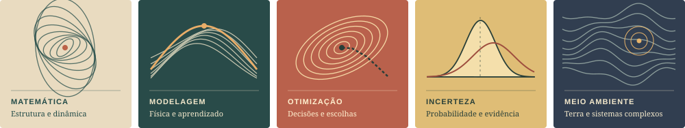
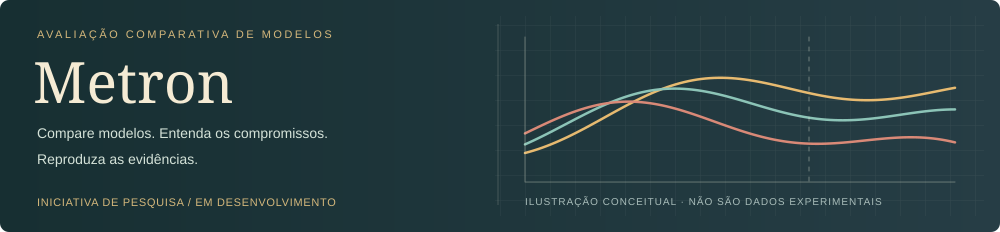

<a href="README.md">English</a> | <strong>Português (Brasil)</strong>

<h1 align="center">Gustavo Bernardo Brito</h1>

  Matemática Aplicada e Ciência Computacional 
  Graduando na Universidade Federal de Goiás (UFG), Brasil.

  Modelagem matemática · Aprendizado de máquina científico · Otimização · Quantificação de incertezas

  <a href="https://gustavobernardo1.github.io">Site (em construção)</a> ·
  <a href="http://lattes.cnpq.br/9675299775092117">Currículo Lattes</a>

  

---

<h2 align="center">Projeto em destaque</h2>

  

  Benchmarking reprodutível de modelos matemáticos, baseados em processos e de aprendizado de máquina. 
  Primeira investigação: modelos de cultivo de soja. Atualmente em elaboração do protocolo. 
  <a href="https://github.com/gustavobernardo1/metron">Repositório</a> · <a href="https://github.com/gustavobernardo1/metron/blob/main/METHODOLOGY.md">Metodologia</a>

## Pesquisa

- **Modelagem agrícola** — lacunas de produtividade e eficiência agrícola da soja.
- **Ciência de dados ambientais** — variabilidade da precipitação e análise hidroclimática no Cerrado brasileiro.

## Projetos e estudos

- [**Pluvia**](https://github.com/gustavobernardo1/pluvia) — exploração aberta da chuva na natureza, ciência, humanidade e cultura.
- **Helios** — previsão solar orientada pela física e otimização estocástica de energia. Em desenvolvimento.
- **Conjectura** — descoberta matemática assistida por IA e verificação formal com Lean 4. Iniciativa independente de pesquisa.
- [**Computational Mathematics**](https://github.com/gustavobernardo1/computational-mathematics) — estudos de métodos numéricos, sistemas dinâmicos e otimização.
- [**Scientific ML**](https://github.com/gustavobernardo1/scientific-ml) — problemas inversos, aprendizado orientado pela física e experimentos reprodutíveis.
- [**Mapa dos Ipês**](https://github.com/gustavobernardo1/mapa-dos-ipes) — ciência cidadã e engenharia geoespacial.

Arte: ilustrações matemáticas conceituais originais, não resultados experimentais. Dados de pesquisa e resultados inéditos são compartilhados somente com autorização.
